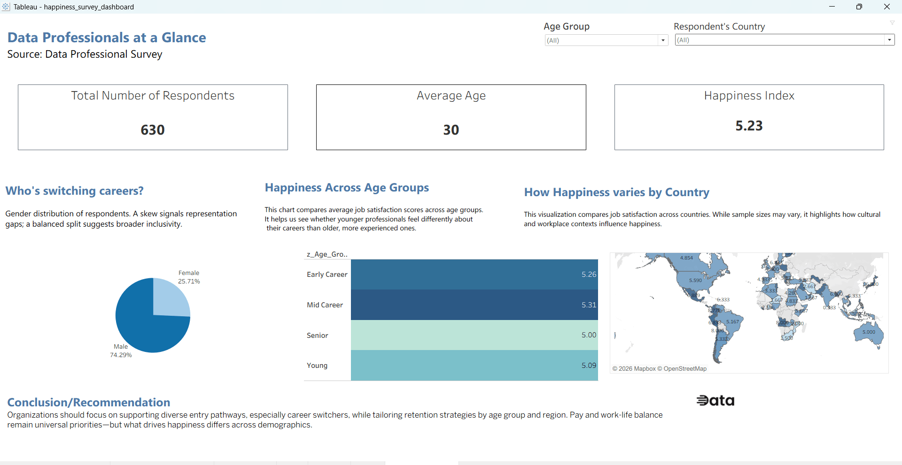
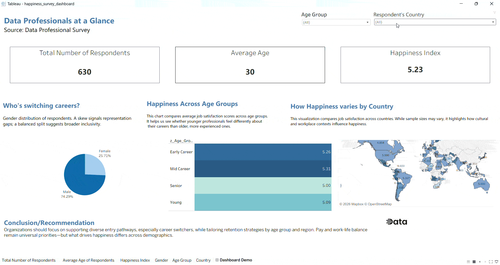

# 📊 Data Professional Happiness Index & Career Analysis

An interactive Tableau dashboard developed to analyze job satisfaction, career transitions, and demographic trends among global data professionals.

---

## 📸 Dashboard Preview

> 💡 **Workbook Access:** To inspect or interact with the full packaged workbook locally, download [`dashboards/happiness_survey_dashboard.twbx`](./dashboards/happiness_survey_dashboard.twbx).

---

## 🎥 Interactive Walkthrough

---

## 🎯 Project Overview & Objectives

Understanding talent retention, workplace expectations, and career entry pathways is critical for analytics organizations. Utilizing survey data from data professionals, this project explores:
1. **Satisfaction Drivers:** Measuring overall job satisfaction (Happiness Index) across career stages and age tiers.
2. **Geographic Distribution:** Identifying regional happiness trends through geographic mapping.
3. **Career Switchers:** Analyzing demographic representations among professionals transitioning into data roles.

---

## 🧰 Tools and Technologies

- Tableau Desktop
- Tableau Calculated Fields
- Data Cleaning and Preparation
- KPI Development
- Geographic Data Visualization
- Dashboard Design and Layout
- Interactive Filters and Dashboard Actions

---

### 🛠️ Key Skills Demonstrated

* **Data Cleaning & Transformation:** Handled missing/irregular text in survey fields using Tableau's `REPLACE()` string function to sanitize country data for spatial visual accuracy.
* **Demographic Segmentation:** Applied custom conditional logic (`IF/THEN/ELSEIF`) to bin continuous age metrics into discrete qualitative career stages (`Young`, `Early Career`, `Mid Career`, `Senior`).
* **Geographic Data Visualization:** Configured spatial data roles (`Country/Region`) and generated a global heatmap using 3-step color gradients to highlight regional satisfaction trends.
* **UI/UX Dashboard Architecture:** Engineered structured visual layouts using nested horizontal and vertical tiled containers to align KPI scorecards, donut charts, bar charts, and maps cleanly.
* **Interactive Filtering & Actions:** Implemented global slicers (`Age Group`, `Country`) and cross-filtering dashboard actions (`Use as Filter`) to enable dynamic stakeholder drill-downs.
* **Quantitative Aggregation & Formatting:** Standardized metric displays using appropriate measure aggregations (such as average happiness rounded to two decimal places) and adjusted column aliases for executive readability.
* **Analytical Communication & Business Framing:** Translated raw survey metrics into actionable workforce insights regarding talent retention, gender representation gaps, and career-stage satisfaction drivers.

